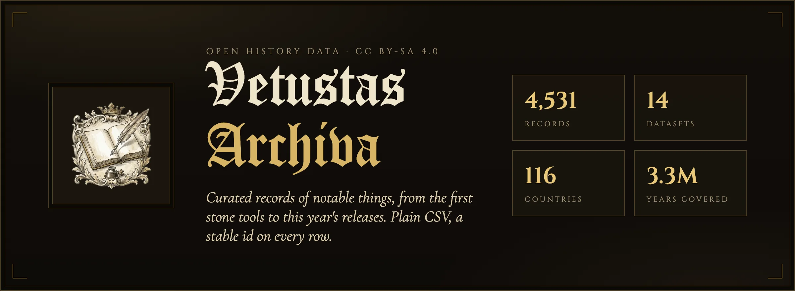
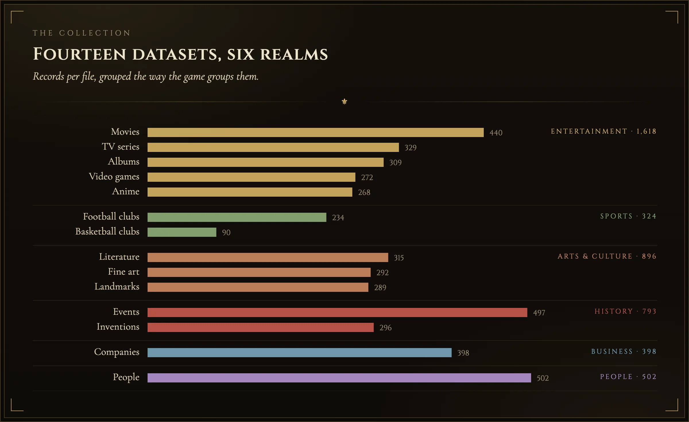
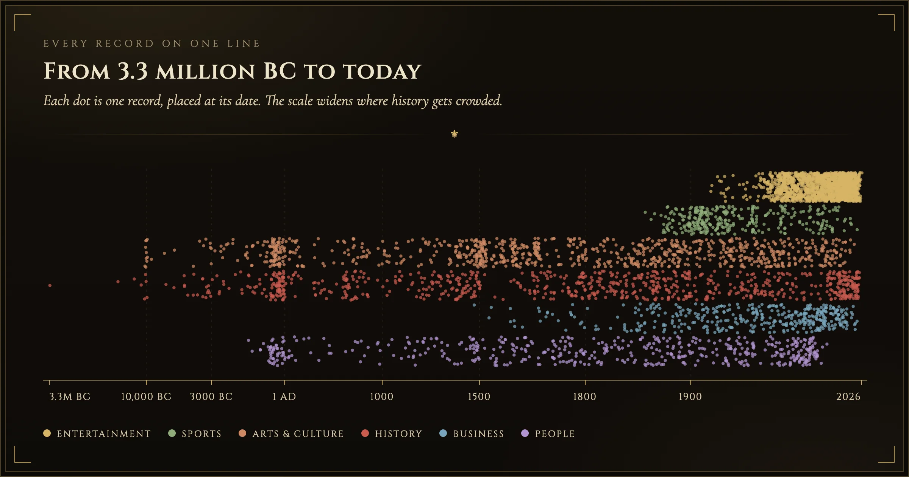
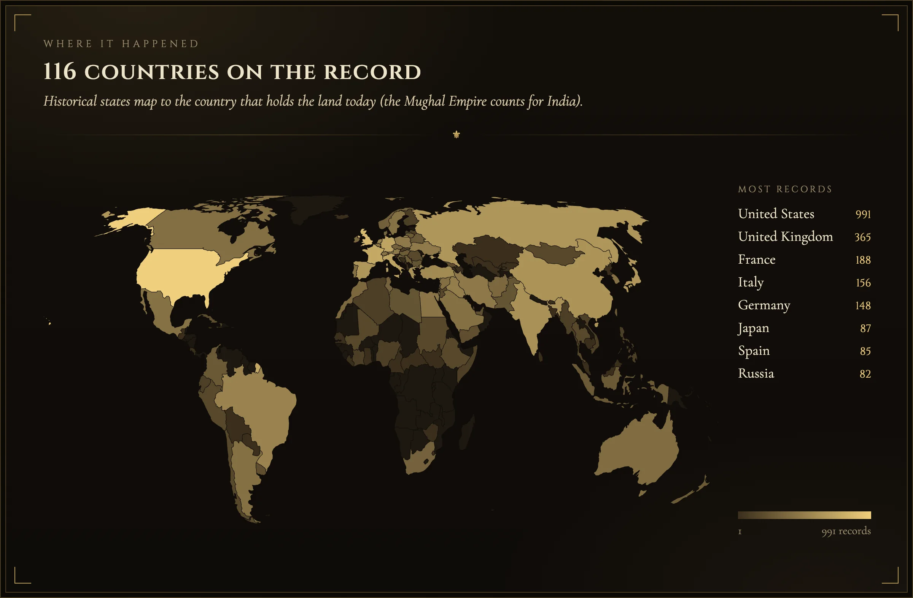
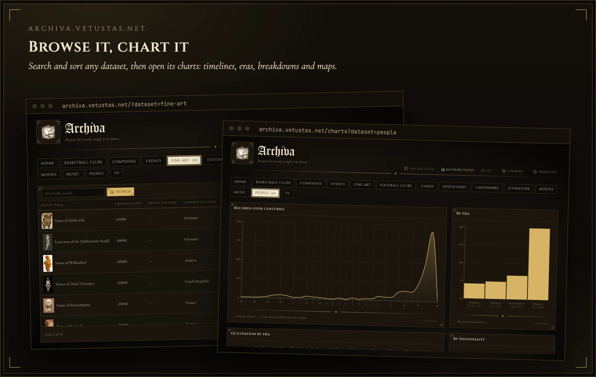
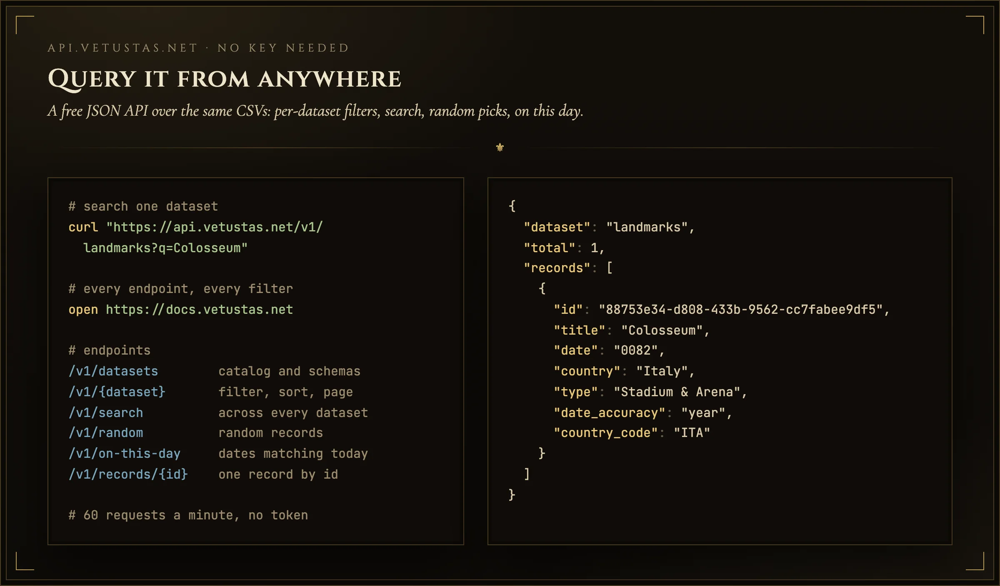
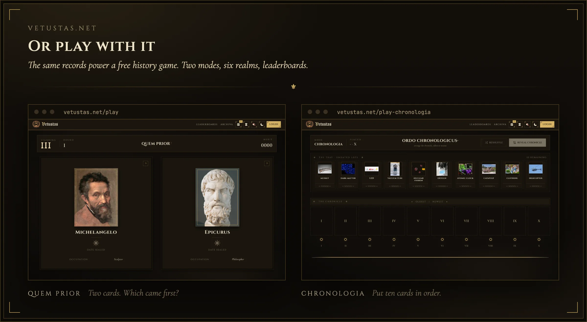

<div align="center">



**Open, curated datasets of notable things across history and culture.**
Movies, music, games, books, people, companies, inventions, landmarks, art and
more, compiled and enriched from public sources into clean, consistent CSVs.

[](datasets/LICENSE)
[](LICENSE)
[](#datasets)
[](#datasets)
[](https://github.com/0xShady/vetustas-archiva/stargazers)
[](https://github.com/0xShady/vetustas-archiva/commits)

[](https://archiva.vetustas.net)
[](https://docs.vetustas.net)
[](https://vetustas.net)

</div>

**4,531 records across 14 datasets.** Plain CSV, one file per subcategory. No build
step needed to use the data: just read the files, or query them through the
[public API](#public-api).

## At a glance







## Datasets

| File                            | Records | What                                               |
| ------------------------------- | ------: | -------------------------------------------------- |
| `datasets/movies.csv`           |     440 | Films, with IMDb ratings, director, genre, runtime |
| `datasets/tv.csv`               |     329 | TV series, seasons/episodes, network, creator      |
| `datasets/anime.csv`            |     268 | Anime, studio, format, AniList scores              |
| `datasets/games.csv`            |     272 | Video games, developer, publisher, series          |
| `datasets/music.csv`            |     309 | Albums, label, tracks, certifications, popularity  |
| `datasets/literature.csv`       |     315 | Books, author, type, language                      |
| `datasets/fine-art.csv`         |     292 | Paintings & sculptures, artist, movement, medium   |
| `datasets/landmarks.csv`        |     289 | Buildings & sites, architect, country              |
| `datasets/people.csv`           |     502 | Notable people, occupation, nationality            |
| `datasets/companies.csv`        |     398 | Companies, founding, industry, type                |
| `datasets/inventions.csv`       |     296 | Inventions & discoveries, inventor, category       |
| `datasets/events.csv`           |     497 | Historical events, type, era                       |
| `datasets/football-clubs.csv`   |     234 | Football clubs                                     |
| `datasets/basketball-clubs.csv` |      90 | Basketball clubs                                   |

## Data format

- UTF-8 CSV, `\r\n` line endings, header row first.
- Every row has a frozen **`id`**: a UUIDv4 that is permanent and globally
  unique. It never changes and is never reused, even if a record is corrected.
  It's the stable key to reference a record over time.
- Dates use signed `YYYY[-MM[-DD]]`, truncated to the real precision (a year-only
  fact is `YYYY`, not `YYYY-01-01`). BC dates are negative, `-YYYY`.
- Image columns (`poster` / `cover` / `logo` / `crest` / `image`) hold **URLs**
  to externally hosted files (this repo doesn't store the images).
- Controlled-vocabulary columns (`genre`, `type`, `category`, `movement`, `era`)
  are normalized to a small canonical set per dataset.

## Using the data

It's just CSV. Open it in anything (pandas, a spreadsheet, `csv` in any
language):

```python
import pandas as pd

movies = pd.read_csv("datasets/movies.csv", dtype=str)
print(movies[["title", "release_date", "imdb_rating"]].head())
```

```typescript
// Use a CSV parser: fields can contain commas and the files use CRLF line endings.
import fs from "fs";
import Papa from "papaparse";

const { data: movies } = Papa.parse<Record<string, string>>(
  fs.readFileSync("datasets/movies.csv", "utf-8"),
  { header: true, skipEmptyLines: true },
);
console.log(movies[0].title, movies[0].release_date, movies[0].imdb_rating);
```

Or grab a single file without cloning:

```bash
curl -O https://raw.githubusercontent.com/0xShady/vetustas-archiva/main/datasets/movies.csv
```

## Explore in the browser



**[archiva.vetustas.net](https://archiva.vetustas.net)** lets you browse, search,
sort and filter every dataset, with interactive charts per column: value counts,
histograms over time and choropleth maps. Nothing to install.

## Public API



The same data, served as JSON at `https://api.vetustas.net`. No token, no sign-up:
**60 requests a minute** per IP.

| Endpoint                     | Returns                                                  |
| ---------------------------- | -------------------------------------------------------- |
| `GET /v1/datasets`           | Every dataset with its record count                      |
| `GET /v1/{dataset}`          | Records of one dataset, with search, filters and paging  |
| `GET /v1/{dataset}/schema`   | Columns and the filters a dataset accepts                |
| `GET /v1/{dataset}/{id}`     | One record by its `id`                                   |
| `GET /v1/search?q=`          | Full-text search across all datasets                     |
| `GET /v1/random`             | A random record (also `/v1/{dataset}/random`)            |
| `GET /v1/on-this-day?date=`  | Records whose date falls on that month and day           |
| `GET /v1/records/{id}`       | One record by `id`, from any dataset                     |

```bash
curl "https://api.vetustas.net/v1/movies?genre=Sci-Fi&min_rating=8&year_min=2000"
curl "https://api.vetustas.net/v1/search?q=apollo"
curl "https://api.vetustas.net/v1/on-this-day?date=11-09"
```

Every endpoint, parameter and filter, with live examples you can run from the
page: **[docs.vetustas.net](https://docs.vetustas.net)**.

## Play the game



Prefer to play with the data? **[Vetustas](https://vetustas.net)** is a free
history trivia game built on these datasets. In **Quem Prior** you pick which of
two things came first; in **Chronologia** you put ten cards in order on a
timeline. Pick a category, an era, and see how long your streak lasts.

## Scripts

The datasets are generated and maintained by a set of Node + Python scripts
under [`scripts/`](scripts/). You only need these to **add or refresh** data;
using the data needs nothing but the CSVs.

```bash
npm install
cp .env.example .env       # add API keys where a source needs one (e.g. TMDB)

npm run expand:movies      # one scraper per dataset (expand:tv, expand:games, ...)
npm run merge -- movies    # append the reviewed rows, stamp ids, sort, validate
npm run validate           # schema, unique ids, dates, https image files
```

The full script reference (every command, what it does and its arguments) is in
[`scripts/README.md`](scripts/README.md).

> Requires Node 24+ and Python 3.

## License

Dual-licensed:

- **Datasets** (`datasets/`): [CC BY-SA 4.0](datasets/LICENSE). Free to use, share
  and adapt (including commercially) with attribution; derivatives stay open
  under the same license.
- **Code** (`scripts/`): [MIT](LICENSE).

Data is compiled from public sources, each under its own terms.
See [`datasets/LICENSE`](datasets/LICENSE) for the full attribution and source notes.

## Contributing

Contributions are welcome and very needed: corrections, new records, new sources.
See [CONTRIBUTING.md](CONTRIBUTING.md) for the rules and how to submit a PR.
